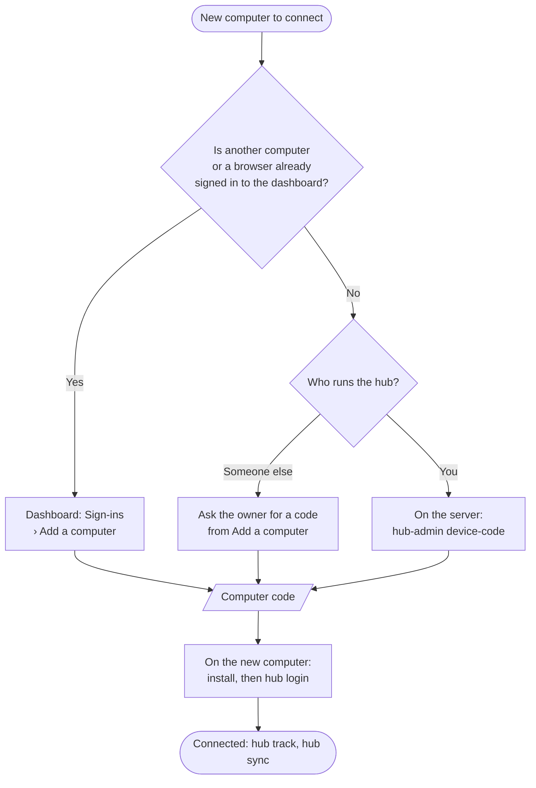
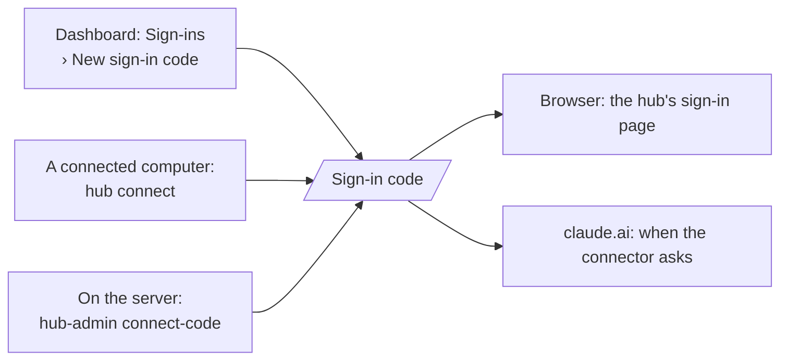

# context-hub

One private place for the AI-assistant history of the projects you choose.
Your sessions from Claude Code, Codex and Antigravity are uploaded (secrets
stripped), summarised, and kept as a short briefing per project, so any
assistant on any account or machine can pick up where the last one stopped:
ask "where did we leave off on jsonroom?" and it reads the briefing instead
of you explaining it again.

It has three parts:

- **The hub**, a small server you or someone else hosts. It stores sessions,
  writes summaries and project briefings, and answers assistants over MCP.
- **The `hub` command** on each computer you work on. It finds your local AI
  sessions and uploads the projects you choose.
- **The dashboard**, the hub's own web pages: health, activity, projects and
  every connection, behind a sign-in.

Pick the section that fits you:

- [Use an existing hub](#use-an-existing-hub): someone (for now, the owner)
  already runs one and you have its address. Start here to connect a new
  computer or the Claude apps.
- [Host your own hub](#host-your-own-hub): run the server yourself.

---

## Use an existing hub

The examples use `https://hub.abdulmughnialfikri.com`; replace it with your
hub's address.

### 1. Read from the hub in the Claude apps

claude.ai, the Claude desktop app's chat and Claude mobile connect as a
custom connector. Add it once, in claude.ai:

1. **Customize > Connectors > Add custom connector.**
2. URL: `https://hub.abdulmughnialfikri.com/mcp`, exactly, with no trailing
   slash. Keep the default settings.
3. When it asks you to sign in, get a one-time code (see
   [Sign-in codes](#sign-in-codes)) and enter it. Leave **"Also allow it to
   save notes"** ticked if you want chats to be able to save notes.

The connector then works in all the Claude apps on that account, with
nothing more to add. **Claude Code signed in to the same account gets it
too**, so on a new computer reading from the hub needs no setup at all.

Ask about a project by name ("where did we leave off on jsonroom?") and
Claude uses the hub. To save something: "save a note to context-hub: …".

After the hub adds or changes tools, claude.ai keeps its old tool list until
you open **Customize > Connectors > context-hub**, click **Disconnect**, then
**Connect**, and sign in again.

### 2. Upload this computer's sessions

Reading needs nothing local. Uploading this computer's own sessions needs
the `hub` command (Node 22 or newer) and a **computer code**: a one-time code,
valid 10 minutes, that `hub login` swaps for this computer's own upload
token.

#### Which path are you on?



| You are | Get the computer code from |
|---|---|
| **Adding another computer** (one computer or browser is already signed in) | The dashboard: **Sign-ins > Add a computer**. It also shows the commands to run. |
| **Using someone else's hub** | The hub's owner, from their **Sign-ins > Add a computer**. You never need server access. |
| **Hosting the hub, first computer ever** (nothing is signed in yet) | The server: `docker exec context-hub node /app/dist/admin-bin.js device-code` (or `docker compose exec … device-code`). |

A computer code only works in `hub login`, and a sign-in code (for browsers
and the Claude apps, see [Sign-in codes](#sign-in-codes)) only works there.
Using one in the other's place just says "wrong or expired" and costs nothing.

#### Install and log in

**macOS and Linux:**

```bash
curl -fsSL https://hub.abdulmughnialfikri.com/install | sh
```

Then run the `login` line it prints, which asks for a name for this computer
and the code. The installer puts `hub` in `~/.local/bin` and installs the
Claude Code slash commands. If `~/.local/bin` is not on your `PATH` (a fresh
Mac), it prints the line to add to `~/.zshrc` and gives the next step with the
full path. Run the install line again to update; it leaves `~/.context-hub`
alone.

**Windows** has no installer yet:

```bash
git clone https://github.com/abdulmuhg/context-hub.git
cd context-hub
pnpm install
pnpm --filter @context-hub/collector build
```

Put a `hub.cmd` in your npm global folder that runs
`node C:\path\to\context-hub\apps\collector\dist\bin.js %*`, then run
`hub login --url https://hub.abdulmughnialfikri.com` and enter the code.

When it works, `hub login` prints `Connected as "<name>"`, and the computer
appears on **Sign-ins > Tokens** with its own **Disconnect**, so a lost
computer can be cut off.

### 3. Choose projects and sync

Day to day, one command is all you need:

```bash
hub sync
```

It uploads your tracked projects. When it finds a project on this computer
that you have not decided on, it asks `Upload it to the hub? [y/N]` and
remembers the answer. Nothing is uploaded without a `y`. Outside a terminal
(for example `/hub-sync`) it never asks; it only tells you how many new
projects it left out.

Advanced, for finer control:

```bash
hub projects                 # every project found on this computer
hub track <project>          # track one without being asked (also undoes a "no")
hub untrack <project>        # stop uploading it (it will not be asked about again)
hub sync --dry-run           # see what would be sent
```

- A project is named by its git remote (`github.com/you/repo`), or
  `local:<folder>` when it has none. A session is filed under the project
  where most of its work happened.
- Secrets (tokens, keys, passwords in URLs) are stripped before anything
  leaves the computer, and again on the server.
- `hub personal add phone` adds one of your own values, such as a phone
  number, to a personal-data list. The default is `warn`: it is reported but
  still uploaded. Raise it with `hub personal level list partial` or `full`.
- Syncing is manual on purpose: run `hub sync` after a working session, or
  use `/hub-sync` in Claude Code.
- `hub forget <project>` or `hub forget --session <source>:<id>` deletes from
  the hub. Local files are never touched.

#### Sync automatically (Claude Code)

```bash
hub auto on        # add a Claude Code SessionEnd hook
hub auto status    # is it on, and what did the last run do
hub auto off       # remove the hook
```

With `hub auto on`, ending a Claude Code session starts a background `hub sync`
of your tracked projects. It returns at once, so closing Claude Code is never
delayed. It never asks and never tracks a new project (new projects wait for
you to run `hub sync` in a terminal), and it adds one line per run to
`~/.context-hub/auto.log`. It is off until you turn it on. The hook is written
to `~/.claude/settings.json`; other settings and hooks there are left alone,
and a backup is saved as `settings.json.hub-backup`.

Codex and Antigravity have no such hook; keep running `hub sync` for them.

**Start each Claude Code session inside the project's folder.** The hub files
a session by where its work happened, so a session started elsewhere can
land in the wrong project.

### 4. Slash commands for Claude Code

`integrations/claude-code/` holds six commands. The installer puts them in
`~/.claude/commands/` for every repo; to install or refresh them yourself:

```bash
hub install-commands
```

| Command | What it does |
|---|---|
| `/hub-sync` | Run `hub sync`: upload every tracked project's new sessions. |
| `/hub-catchup` | Read this project's briefing, check the live git state, and say where things stand. |
| `/hub-note <text>` | Save a note to this project. Needs the claude.ai connector with "save notes" allowed. |
| `/hub-status` | Whether this project is tracked, when it last synced, the hub's totals, and whether automatic sync is on. |
| `/hub-track` | Start tracking this project. |
| `/hub-auto on\|off\|status` | Turn automatic sync on or off, or show its last run. |

Each works out the project from the folder's `origin` remote, or the folder
name when there is none.

### 5. The dashboard

Open the hub's address in a browser: https://hub.abdulmughnialfikri.com.
Signed out, every page is the sign-in screen. Sign in with a one-time code;
the browser stays signed in for 30 days.

| Page | What it shows |
|---|---|
| **Overview** | Healthy or Needs attention, counts, the last sync, the last backup (and whether it reached off-site storage), anything wrong right now, recent activity, and the running version. |
| **Activity** | Everything saved into the hub and read from it over the last 30 days, and by whom. |
| **Projects** | Every project and its summary; open one for its full briefing, recent sessions and notes. |
| **Sign-ins** | Every way in: Claude apps, tokens and browsers, each with a **Disconnect** that asks once and says what breaks. |

### Sign-in codes

The dashboard (in a browser) and the Claude apps sign in with a **sign-in
code**: one-time, valid 10 minutes.



Use whichever source you can reach: the dashboard if any browser is already
signed in, `hub connect` on a computer that is already connected, or the
server if neither. Ten wrong codes in 5 minutes block that address for 15
minutes.

### Keeping the hub's picture right

- A project's briefing is only as current as the last sync, and it records
  what was said in sessions, not what happened elsewhere (a pull request
  merged on GitHub, a setting changed). Assistants are told to check git and
  the live service before relying on it.
- When a briefing is wrong, ask any chat to save a correcting note to that
  project. The briefing updates within a minute.

---

## Host your own hub

You need a Linux server with Docker, a domain name pointing at it, and an
HTTPS reverse proxy in front. The hub is one container with one SQLite file
on a volume.

**The quickest route is the [`deploy/`](deploy) folder:** a ready
`docker-compose.yml` with Caddy (which gets the HTTPS certificate by itself),
a settings template and a nightly backup script, with step-by-step
instructions in [`deploy/README.md`](deploy/README.md).

### Build and run

The repo's `Dockerfile` builds the image and runs the typecheck and the
whole test suite as part of the build:

```bash
docker build -t context-hub .
```

The reference deployment builds it in GitHub Actions
(`.github/workflows/deploy.yml`, which only runs on the original repository),
pushes it to GHCR, and has the server pull it, so the server never builds.

A minimal run without the `deploy/` folder:

```bash
docker run -d --name context-hub \
  -v context_hub_data:/data \
  -e PUBLIC_URL=https://hub.example.com \
  -e ANTHROPIC_API_KEY=sk-ant-... \
  -p 127.0.0.1:3000:3000 \
  context-hub
```

Point your HTTPS proxy at port 3000. Keep the container off the public
interface; only the proxy should reach it.

### Settings

| Variable | Needed | What it does |
|---|---|---|
| `PUBLIC_URL` | for the Claude apps and the dashboard's secure cookies | The hub's public address, e.g. `https://hub.example.com`. Turns on sign-in for the Claude apps. No path, no trailing slash. |
| `ANTHROPIC_API_KEY` | for summaries | Writes session summaries and project briefings with Claude. Without it, uploads and lookups still work and summaries wait in a queue. Billed separately from a Claude subscription. |
| `DIGEST_MODEL` | no | Default `claude-haiku-5-5`. |
| `DIGEST_EFFORT` | no | Default `low`. |
| `DIGEST_MAX_INPUT_TOKENS` | no | Default `80000`. Long sessions are summarised in parts of this size. |
| `IMAGE_TAG` | no | Shown on the dashboard as the running version. The reference deploy sets it. |
| `BACKUP_STATUS_PATH` | no | A JSON file the backup job writes; the dashboard shows it. Default `/backup-status/context-hub.json` when it exists. |
| `DATABASE_PATH`, `PORT` | no | Defaults `/data/hub.sqlite` and `3000` in the image. |

### First tokens and first sign-in

There are no accounts. Access is by tokens and one-time codes. On a new hub,
nothing is signed in yet, so the first codes come from the admin command
inside the container:

```bash
docker exec context-hub node /app/dist/admin-bin.js device-code
docker exec context-hub node /app/dist/admin-bin.js connect-code
```

- `device-code` connects your first computer: run the installer there and
  enter it in `hub login` (see [Which path are you on?](#which-path-are-you-on)).
- `connect-code` signs in your first browser (the dashboard) or claude.ai.

From then on you rarely need the server: the dashboard's **Sign-ins** page
makes both kinds of code (**Add a computer**, **New sign-in code**), and
lists and disconnects everything.

You can still create long-lived tokens by hand, for example a read token for
an assistant that cannot use the Claude apps' sign-in (it goes in as a bearer
token for `https://hub.example.com/mcp`):

```bash
docker exec context-hub node /app/dist/admin-bin.js token create --label claude-code --scope read
```

A token is shown once. `ingest` tokens are for a computer's `hub` command;
`read` tokens are for assistants.

Other admin commands:

```bash
node /app/dist/admin-bin.js token list | token revoke <id>
node /app/dist/admin-bin.js oauth list | oauth revoke <id>
node /app/dist/admin-bin.js device-code | connect-code
node /app/dist/admin-bin.js digests
node /app/dist/admin-bin.js redigest <project>
node /app/dist/admin-bin.js rebuild-state <project>
node /app/dist/admin-bin.js backup <file>
```

### Backups

Copying the SQLite file while the server runs is not safe. Use
`admin-bin.js backup <file>`, which takes a consistent copy. The reference
setup runs a nightly script that does that, keeps 14 days locally, uploads to
S3-compatible storage (Cloudflare R2), and writes the status file the
dashboard reads. Mount only that status folder into the container,
read-only.

### Monitoring

`/healthz` answers `{"status":"ok"}` without a sign-in. `/` is the dashboard
and redirects to `/login` when signed out.

---

## Develop

```bash
pnpm install
pnpm test
pnpm typecheck
```

Run the server locally:

```bash
pnpm --filter @context-hub/server build
DATABASE_PATH=./data/hub.sqlite node apps/server/dist/main.js
```

Designs and plans are in [`docs/superpowers/`](docs/superpowers); see its
README for how to read them.

## Contributing

Contributions are welcome. Read [CONTRIBUTING.md](CONTRIBUTING.md) for setup,
the privacy rules every change must keep, and what a pull request needs.
Report security problems privately, as [SECURITY.md](SECURITY.md) describes.
Everyone taking part follows the [Code of Conduct](CODE_OF_CONDUCT.md).

## Status

Live at https://hub.abdulmughnialfikri.com, used by its owner. Every push to
`main` deploys.

| Built | Planned or parked |
|---|---|
| Collector for Claude Code, Codex and Antigravity; secret stripping and a personal-data filter | Windows installer |
| Summaries and per-project briefings, with a review step that drops settled items | Importer for claude.ai export files (waits on a real export) |
| MCP lookups for Claude Code and other tools | ChatGPT and Gemini sign-in |
| Sign-in for claude.ai, desktop and mobile; `save_note` | A hub for more than one person |
| Dashboard, activity log, sync reports, off-site backups | |

## License

[MIT](LICENSE)
