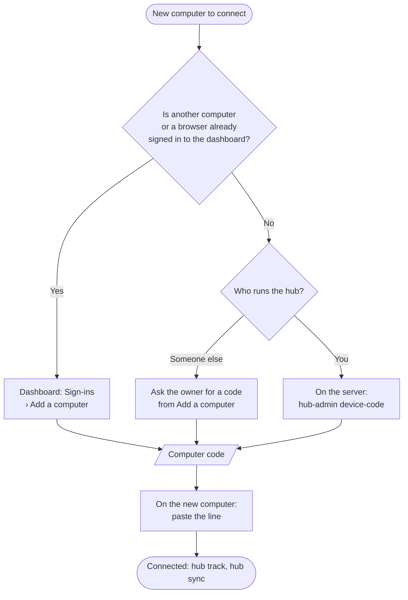
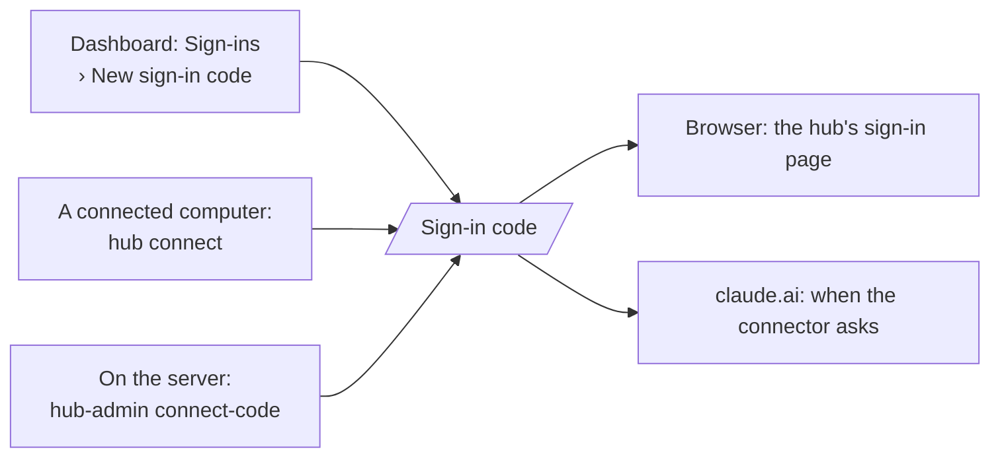

# Using a hub

The examples use `https://hub.abdulmughnialfikri.com`; replace it with your
hub's address.

## 1. Read from the hub in the Claude apps

claude.ai, the Claude desktop app's chat and Claude mobile connect as a
custom connector. Add it once, in claude.ai:

1. **Customize > Connectors > Add custom connector.**
2. URL: `https://hub.abdulmughnialfikri.com/mcp`. The hub also answers on
   `/mcp/`, but use the form without the slash. Keep the default settings.
3. When it asks you to sign in, get a one-time code (see
   [Sign-in codes](#sign-in-codes)) and enter it. Leave **"Also allow it to
   save notes"** ticked if you want chats to be able to save notes.

The connector then works in all the Claude apps on that account, with
nothing more to add. **Claude Code signed in to the same account gets it
too**, so on a new computer reading from the hub needs no setup at all.

Ask about a project by name ("where did we leave off on jsonroom?") and
Claude uses the hub. To save something: "save a note to context-hub: …".

After the hub adds or changes tools, claude.ai keeps its old tool list until
you open **Customize > Connectors > context-hub**, click **Disconnect**, then
**Connect**, and sign in again.

## 2. Upload this computer's sessions

Reading needs nothing local. Uploading this computer's own sessions needs
the `hub` command (Node 22 or newer) and a **computer code**: a one-time code,
valid 10 minutes, that the install line (or `hub login`) swaps for this computer's own
upload token.

### Which path are you on?



| You are | Get the computer code from |
|---|---|
| **Adding another computer** (one computer or browser is already signed in) | The dashboard: **Sign-ins > Add a computer**. It also shows the line to paste for each OS, with the code inside. |
| **Using someone else's hub** | The hub's owner, from their **Sign-ins > Add a computer**. You never need server access. |
| **Hosting the hub, first computer ever** (nothing is signed in yet) | The server: `docker compose exec context-hub hub-admin setup`, which prints the install line with the code inside. |

A computer code only works in the install line or `hub login`, and a sign-in code (for browsers
and the Claude apps, see [Sign-in codes](#sign-in-codes)) only works there.
Using one in the other's place just says "wrong or expired" and costs nothing.

### Install and log in

Open **Sign-ins > Add a computer** on the dashboard. It shows one line for
each OS with the code already inside. Paste the one for the new computer:

**macOS and Linux:**

```bash
curl -fsSL https://hub.abdulmughnialfikri.com/install | sh -s -- --code ABCD-EFGH
```

**Windows** (PowerShell, no extra setup):

```powershell
$env:HUB_CODE='ABCD-EFGH'; irm https://hub.abdulmughnialfikri.com/install.ps1 | iex
```

(`ABCD-EFGH` stands for your own code.) The line needs Node 22 or newer; if it
is missing, the installer says how to get it and to paste the same line again.
It installs `hub`, puts it first on your `PATH`, then runs `hub setup`, which
connects the computer, installs the Claude Code slash commands, turns on
[automatic sync](#sync-automatically-claude-code), prints a checklist of what
is now true, and asks which of the projects found on this computer to upload.
It then runs the first sync while you watch. Every change it makes to your
`PATH` or to `~/.claude/settings.json` appears in the checklist.

Paste the line again, with a fresh code, to update or repair a computer: it
keeps the login and the settings you changed, and retires the computer's old
token. A line without a code (`curl … | sh`) updates and checks without logging
in again.

If you would rather type it yourself, `hub login` still works: it asks for the
hub address, a name for the computer and the code.

When it works, the checklist says `Connected to … as "<name>"`, and the
computer appears on **Sign-ins > Tokens** with its own **Disconnect**, so a
lost computer can be cut off.

## 3. Choose projects and sync

Day to day, one command is all you need:

```bash
hub sync
```

It uploads your tracked projects. When it finds a project on this computer
that you have not decided on, it asks `Upload it to the hub? [y/N]` and
remembers the answer. Nothing is uploaded without a `y`. Outside a terminal
(for example `/hub-sync`) it never asks; it only tells you how many new
projects it left out.

Advanced, for finer control:

```bash
hub projects                 # every project found on this computer
hub track <project>          # track one without being asked (also undoes a "no")
hub untrack <project>        # stop uploading it (it will not be asked about again)
hub sync --dry-run           # see what would be sent
```

- A project is named by its git remote (`github.com/you/repo`), or
  `local:<folder>` when it has none. A session is filed under the project
  where most of its work happened. An SSH host alias such as
  `git@github.com-work:you/repo` counts as `github.com/you/repo`, and a
  session from a Claude Code worktree that has since been removed is filed
  under its repo.
- Secrets (tokens, keys, passwords in URLs) are stripped before anything
  leaves the computer, and again on the server.
- Card numbers are masked to their last four digits by default
  (`hub personal level card partial`); `full` removes them, `warn` only
  reports them.
- `hub personal add phone` adds one of your own values, such as a phone
  number, to a personal-data list. The default is `warn`: it is reported but
  still uploaded. Raise it with `hub personal level list partial` or `full`.
- Syncing is manual unless you turn on [automatic sync](#sync-automatically-claude-code):
  run `hub sync` after a working session, or use `/hub-sync` in Claude Code.
- `hub forget <project>` or `hub forget --session <source>:<id>` deletes from
  the hub. Local files are never touched.

### Upload your notes as documents

Session summaries are written on your computer by Claude Code (see below). The
notes you keep yourself, such as
ticket write-ups, decision logs or an assistant's memory folder, can go up as
they are:

```bash
hub docs add .claude/knowledge --exclude archive,sessions   # project taken from the folder's repo
hub docs add ~/.claude/projects/<folder>/memory --project my-repo --as memory
hub docs                                                     # list folders
hub docs remove memory                                       # stop uploading one
```

The project must already be tracked (`hub track`): adding notes never starts
uploading a project's sessions. Every `.md` file in the folder, at any depth,
becomes one document of that project; hidden files and the names after
`--exclude` are left out. A folder inside, or around, one already added is
refused. `hub sync`
(and `hub auto`) uploads a document when it changes and removes it from the
hub when its file is deleted or renamed. A missing folder removes nothing.
The id is `doc:<project>#<label>/<path>`, the same on every computer, so the
same notes synced from two machines stay one document.

Documents are not summarised. Assistants see them listed in `get_project`,
find them with `search` (source `doc`), and read them whole with
`get_session`. Secrets and personal data are stripped exactly as for sessions.

### Summaries come from Claude Code on your computer

`hub sync` writes each session's summary, and each project's briefing page,
with Claude Code (`claude -p`) on your own computer. The hub only stores,
searches and serves them, so it needs no model key. A session is uploaded
together with its summary; if the summary cannot be written, the session waits
on the computer, is not on the hub yet, and the next sync tries again.

What this computer needs: Claude Code installed and signed in
(`claude auth login`). `hub doctor` checks it. Without it, a hub that has a
model key summarises this computer's sessions itself; a hub without one leaves
them waiting here.

Antigravity (`agy`, model `gemini-3.8-flash-low`) can write summaries too, but
only if you choose it, because it sends your transcripts to your Google account
and `agy` cannot yet be started with its tools turned off:

- `hub summaries provider auto` uses Claude Code, then Antigravity for the rest
  of a run when Claude Code is signed out or hits its usage limit.
- `hub summaries provider antigravity` uses only Antigravity.
- `hub summaries provider claude-code` goes back to the default.

- The default model is `claude-haiku-5-5` at low effort. `hub summaries` shows
  the settings; `hub summaries model <id>` and `hub summaries effort <level>`
  change them for this computer.
- **Summaries use your Claude plan's usage limits**, the same ones your own
  Claude Code work uses. One sync writes at most 20 new summaries, newest
  first, so a sync cannot use up your plan. `hub sync --all` lifts the cap,
  for catching up on a backlog. A usage limit, a sign-out or a timeout stops
  summary work for that run.
- **Your sessions go through your Claude account**, so they follow that
  account's privacy settings, including whether chats may be used to improve
  the models (claude.ai, **Settings > Privacy**). The hub's fallback key is an
  API key, which is never used for training.
- `hub status` and `hub doctor` show how many sessions are waiting and why.
- `hub resummarize [<project>]` rewrites summaries the hub's own key wrote
  (and pending, failed or refused ones) from the transcripts stored on the
  hub, then rebuilds the project pages. Add `--model-not <id>` to also rewrite
  other computers' summaries that were not written with that model. It counts
  against your plan like a sync, so run it per project rather than with
  `--all` unless you mean to.
- Claude Code is started from an empty folder, with every `ANTHROPIC_*` and
  `CLAUDE*` variable removed (except `CLAUDE_CONFIG_DIR`) and without your
  user settings (`--setting-sources project`), so it always uses your stored
  Claude login. A proxy or another account set in `~/.claude/settings.json`
  does not apply, and an API account is never billed. These runs leave no
  transcripts behind.

### Sync automatically (Claude Code & Antigravity)

```bash
hub auto on        # add Claude Code SessionEnd + Antigravity Stop hooks
hub auto status    # is it on, and what did the last run do
hub auto off       # remove the hooks
```

With `hub auto on`, ending a Claude Code session or stopping an Antigravity turn
starts a background `hub sync` of your tracked projects. It returns at once, so
closing Claude Code or Antigravity is never delayed. It never asks and never
tracks a new project (new projects wait for you to run `hub sync` in a terminal),
and it adds one line per run to `~/.context-hub/auto.log`. It is turned on for
you by the first install; after that it stays as you set it. The hooks are
written to `~/.claude/settings.json` and `~/.gemini/config/hooks.json`; other
settings and hooks there are left alone, and backups are saved as
`*.hub-backup`.

Codex has no such hook; keep running `hub sync` for it.

**Start each Claude Code or Antigravity session inside the project's folder.**
The hub files a session by where its work happened, so a session started
elsewhere can land in the wrong project.

## 4. Slash commands & Antigravity skills

`integrations/claude-code/` holds six Claude Code commands, and
`integrations/antigravity/skills/` holds six matching Antigravity skills. The
installer puts them in `~/.claude/commands/` and `~/.gemini/config/skills/`;
to install or refresh them yourself:

```bash
hub install-commands
```

To read from the hub inside Antigravity, add the hub's MCP endpoint with a
read-scope token (`hub-admin token create --label antigravity --scope read`):

```bash
agy mcp add --header "Authorization: Bearer <read-token>" context-hub https://hub.abdulmughnialfikri.com/mcp
```

| Command | What it does |
|---|---|
| `/hub-sync` | Run `hub sync`: upload every tracked project's new sessions. |
| `/hub-catchup` | Read this project's briefing, check the live git state, and say where things stand. |
| `/hub-note <text>` | Save a note to this project. Needs the claude.ai connector with "save notes" allowed. |
| `/hub-status` | Whether this project is tracked, when it last synced, the hub's totals, and whether automatic sync is on. |
| `/hub-track` | Start tracking this project. |
| `/hub-auto on\|off\|status` | Turn automatic sync on or off, or show its last run. |

Each works out the project from the folder's `origin` remote, or the folder
name when there is none.

## 5. The dashboard

Open the hub's address in a browser: https://hub.abdulmughnialfikri.com.
Signed out, every page is the sign-in screen. Sign in with a one-time code;
the browser stays signed in for 30 days.

| Page | What it shows |
|---|---|
| **Overview** | Healthy or Needs attention, counts, the last sync, the last backup (and whether it reached off-site storage), anything wrong right now, recent activity, and the running version. A **Model spend** card shows what the hub's own fallback key spent today (UTC day), the calls made today and the last 30 days, and the daily limit when one is set. `hub-admin usage [--days N]` gives the same per day, by kind and by project. |
| **Activity** | Everything saved into the hub and read from it over the last 30 days, and by whom. Under a computer's name it says what started the upload: a terminal, `/hub-sync`, auto sync, or no terminal (anything else, such as a script). |
| **Projects** | Every project and its summary; open one for its full briefing, recent sessions and notes, and its documents. |
| **Sign-ins** | Every way in: Claude apps, tokens and browsers, each with a **Disconnect** that asks once and says what breaks. |

## Sign-in codes

The dashboard (in a browser) and the Claude apps sign in with a **sign-in
code**: one-time, valid 10 minutes.



Use whichever source you can reach: the dashboard if any browser is already
signed in, `hub connect` on a computer that is already connected, or the
server if neither. Ten wrong codes in 5 minutes block that address for 15
minutes.

## Keeping the hub's picture right

- A project's briefing is only as current as the last sync, and it records
  what was said in sessions, not what happened elsewhere (a pull request
  merged on GitHub, a setting changed). Assistants are told to check git and
  the live service before relying on it.
- `hub sync` also checks each page against git. For a project checked out on
  the computer that syncs, it runs `git fetch`, reads the default branch and
  local branches, and (when `gh` is installed and signed in) the latest pull
  requests. Lines that git shows are settled, such as an open item naming a
  merged PR, are dropped, and the page ends with a short `## Git` section that
  says which computer checked and when. It re-checks when the facts change,
  even with no new session. Without a checkout, git, or network, it is skipped
  and the page keeps its last `## Git` section. The hub learns where a project
  is checked out from the folder of its next new session, or from running
  `hub sync` inside it.
- When a briefing is wrong, ask any chat to save a correcting note to that
  project. The briefing updates within a minute.
